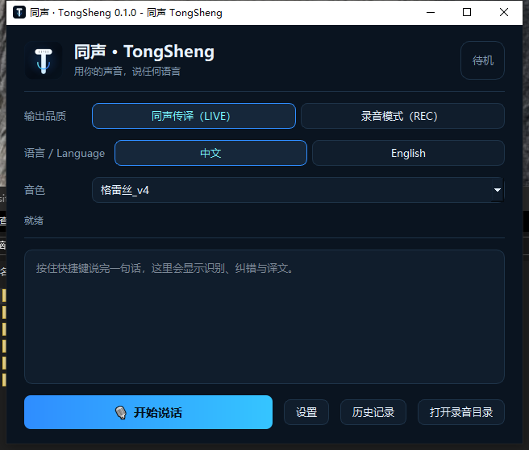

# 同声 · TongSheng

**English** | [中文](README.md)

**A local voice translator for Windows: hold a hotkey, speak, and hear it in your own cloned voice.**

ASR → correction → translation → GPT-SoVITS v4 voice cloning, entirely on your machine.
Audio never leaves the box.

> Author: **Ahee52**
> Status: **1.1.11**
> Packaged build: **TongSheng-1.1.3-Setup** — ~14.1 GB installed, 10.67 GB installer (1 exe + 7 bins)
> Install dir: `%ProgramFiles%\TongSheng`
> Config / logs: `<install>\config.yaml`, `<install>\logs\app.log`

---

## ⚠️ Before you start

**Cloning a voice requires explicit, revocable consent from its owner.**

Train only your own voice, or a voice you hold written permission for. Explicitly prohibited:
impersonation, fraud, harassment, sexual content, or misleading material. You are responsible
for complying with local law.

---

## What this is

A system-tray tool: press a hotkey, speak one sentence, and it comes back in another language,
spoken with the voice you trained.

```
hotkey → ASR → correction → translation → GPT-SoVITS v4 → speakers / results\rec
```

It stitches together two working projects:

| Project | Contribution |
|---|---|
| **A — PrivateVoice** | GPT-SoVITS inference and training, voice library |
| **B — ALT-VoiceType** | ASR adapters, correction/translation prompts, llama-server supervision, Alt gesture |

---

## Requirements

| Item | Minimum | Recommended |
|---|---|---|
| OS | Windows 10 x64 (21H2+) | Windows 11 x64 |
| GPU | RTX 2060 / 6 GB VRAM | RTX 3090 / 4070 Ti class, 16–24 GB |
| Driver | CUDA 12.8 capable (≥ 570.x) | latest |
| RAM | 16 GB | 32 GB |
| Disk | 15 GB free | 30 GB |

Inference keeps ~4–6 GB of VRAM resident (ASR + TTS + two local LLM servers).
CPU inference is not supported. Bluetooth/HDMI audio is out of scope; 3.5 mm and USB cards work.

---

## Two ways to run

| Route | For | Needs |
|---|---|---|
| **Installer** | End users | 1 `.exe` + 2 `.bin` slices |
| **Source** | Development | Python 3.12, NVIDIA GPU, ~20 GB disk, models |

### From source

```bat
git clone <this repo> TongSheng
cd TongSheng
python -m venv .venv && .venv\Scripts\activate
pip install torch==2.11.0 torchaudio==2.11.0 --index-url https://download.pytorch.org/whl/cu128
pip install -r requirements.txt

run.bat            :: tray mode
run.bat doctor     :: environment check
```

The app auto-discovers sibling checkouts of PrivateVoice (GPT-SoVITS weights, ASR cache) and
ALT-VoiceType (GGUF models). Override with `paths:` in `config.yaml`.

Two llama.cpp servers are started on demand: **corrector 8093 / translator 8094** (deliberately
away from project B's 8091/8092). Already-healthy servers are reused, never duplicated.

---

## The interface



| Element | Meaning |
|---|---|
| **录音 / Save synthesised audio** | When on, every take is kept in `results/rec`; when off, cached wavs are deleted after 3 minutes |
| **输入语言** | Chinese → FunASR paraformer; English → faster-whisper; switches the ASR model and warms it |
| **输出语言** | 15 targets; zh/en/ja/ko/yue can be spoken, the other 11 are text-only |
| **音色** | Cloned voices from `voice-repository/` |
| **语速** | Speaking rate (project A recommends 0.92) |
| **模型预热** | Preload ASR / TTS / LLM servers to remove the first-sentence stall |
| **声音模型训练** | Voice library: create / import / set default / delete |

Hotkey: **right Alt** by default (smart mode: tap to latch, hold to talk). `ESC` cancels at any
stage. The hook listens without swallowing keys, so Alt+Tab / Alt+F4 keep working.

---

## Pipeline

| Stage | Chinese | English |
|---|---|---|
| ASR | FunASR Paraformer-zh | faster-whisper small |
| Correction | Qwen3-1.7B via llama.cpp | same |
| Translation | Index-Translate 2B / 9B | same |
| Synthesis | GPT-SoVITS **v4 + LoRA**, 48 kHz, 12 steps | same |

There is a **single synthesis pipeline** since 1.1.0: the former "REC" parameters, whole-text
rendering, 80 ms sentence gaps, 12/25 ms fades. No more quality tiers — the voice is always the
one you trained.

Spoken: 中文, English, 日本語, 한국어, 粤语. Text-only: Español, Français, Deutsch, Русский,
Português, Italiano, العربية, Tiếng Việt, ไทย, Bahasa Indonesia, Türkçe.

---

## Configuration (highlights)

| Key | Default | Meaning |
|---|---|---|
| `ui.language` | `zh` | Input language + UI language |
| `ui.record_output` | `false` | Save takes to `results/rec` |
| `ui.hotkey` / `ui.hotkey_mode` | `ralt` / `smart` | Shortcut and gesture |
| `translate.target_language` | `""` | Empty = auto (opposite of input) |
| `tts.speed` | `1.0` | Speech rate |
| `tts.sentence_gap_ms` | `80` | Pause between sentences |
| `pipeline.inject_text` | `false` | Paste the translation at the caret |

---

## Packaging

```bat
python tools\build_package.py --stage
python tools\make_installer_assets.py
"%LOCALAPPDATA%\Programs\Inno Setup 6\ISCC.exe" installer\TongSheng.iss
```

The result lands in `dist\installer\` (10.67 GB total, LZMA2 ratio ~0.74): one 6 MB
`TongSheng-1.1.3-Setup.exe`, seven `TongSheng-1.1.3-Setup-N.bin` slices of 1.77 GB (under
GitHub's 2 GB per-asset limit) and `SHA256SUMS.txt`.
The wizard is English-only and uses the same dark artwork and microphone icon as the app.
Upload the `.exe` **and every `.bin`** to the release - a missing slice aborts the install.

| Component | MB |
|---|---:|
| Python runtime (torch / PySide6 / onnxruntime) | 5888 |
| ASR models (paraformer + ct-punc + whisper small) | 2681 |
| LLM weights (Qwen3-1.7B Q8 + Index-Translate 2B Q4) | 2995 |
| GPT-SoVITS code + v4 pretrained weights | 2527 |
| Default_Voice | 221 |
| llama-server | 168 |
| App code and docs | 6 |
| **Total** | **14480 (≈14.1 GB)** |

See [docs/INSTALLER-SIZE.md](docs/INSTALLER-SIZE.md) for the exclusion list (training artifacts,
logs, the v3 vocoder, the duplicate ASR download).

---

## FAQ

**No sound?** Check `logs/app.log` for the `speak` line; confirm the voice folder has both the GPT
checkpoint and the SoVITS LoRA.

**"Server not ready after 90s"?** Ports 8093/8094 may be taken, or a system proxy is intercepting
localhost (1.0.3+ bypasses the proxy for local requests, and the installer sets
`ProxyOverride=127.0.0.1;localhost;<local>`).

**Hotkey dead?** The listener is health-checked every 3 seconds and reinstalls itself; check
`logs/app.log` for `hotkey ready`.

**Is the install healthy?**
Start menu -> **Self-test** (or `runtime\python.exe tools\selftest.py`). It checks the GPU,
model folders, audio endpoints, the English front-end, ASR, synthesis and the training
backend; the report is `logs\selftest.txt`.

**Where are recordings?** `results/rec/` while the switch is on; deleted after ~3 minutes when off.

---

## License

Code: **MIT** — see [LICENSE](LICENSE). Third-party components and model weights keep their own
terms; see [THIRD_PARTY.md](THIRD_PARTY.md).

## Credits

GPT-SoVITS (MIT), FunASR (MIT), faster-whisper (MIT), CTranslate2 (MIT), llama.cpp (MIT),
PySide6 (LGPLv3, dynamically linked), ModelScope (Apache-2.0), Index-Translate models.

Integration by **Ahee52**, built on Project A (PrivateVoice) and Project B (ALT-VoiceType).
