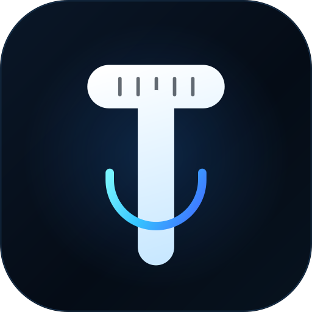

<div align="center">



# 同声 · TongSheng

**用你的声音，说任何语言。**
*Your voice, any language.*

实时语音翻译 · GPT-SoVITS 音色克隆 · 全本地运行

</div>

---

同声（TongSheng）是一个 Windows 系统托盘小工具：按下快捷键说话，它把你说的话识别出来、纠错、翻译成另一种语言，然后用**你自己训练出来的声音**读出来。

- 输入语言：中文 / English（切换即换 ASR 模型，并自动预热）
- 输出语言：Index-Translate 支持的 **15 种**；其中 中/英/日/韩 可直接用克隆音色朗读
- 两档输出品质：**LIVE 24 kHz 实时同传**（低延迟、边说边译）与 **REC 48 kHz 录音模式**（整句合成、音质优先）
- 音频不出本机：ASR、纠错、翻译、合成全部在本地跑

> 声音克隆需要声音所有者的明确授权。请只训练**你本人的声音**，或已获得书面许可的声音。

---

## 它是怎么工作的

```
        ┌──────────┐   ┌──────────┐   ┌──────────┐   ┌──────────┐   ┌──────────┐
麦克风 → │ ASR 识别  │ → │ 纠错      │ → │ 翻译      │ → │ 音色合成  │ → 扬声器
        │ FunASR   │   │ Qwen3-1.7B│   │Index-Trans│   │GPT-SoVITS│
        │ Whisper  │   │ LLM       │   │9B / 2B    │   │live / rec│
        └──────────┘   └──────────┘   └──────────┘   └──────────┘
```

| 阶段 | 中文 | 英文 | 说明 |
|---|---|---|---|
| 识别 | FunASR Paraformer-zh | faster-whisper small | 切换输入语言即换模型并预热 |
| 纠错 | Qwen3-1.7B（llama.cpp） | 同左 | 只改识别错误，不改原意；改动过大自动回退 |
| 翻译 | Index-Translate-9B | 同左 | 口语化意译，不是逐字直译 |
| 合成 | GPT-SoVITS v3 / v4 | 同左 | 同一个克隆音色，两档品质 |

### 输出语言

`中文 / English / 日本語 / 한국어` 四门语言可以直接用你的克隆音色朗读（GPT-SoVITS 前端支持 zh/en/ja/ko/yue）。

`Español / Français / Deutsch / Русский / Português / Italiano / العربية / Tiếng Việt / ไทย / Bahasa Indonesia / Türkçe`
这 11 种语言 Index-Translate 能翻译，但 GPT-SoVITS 还发不出对应语种的音 —— 选到它们时程序会
**只输出文字译文**（界面上标注「仅文字」，转录区和粘贴都不受影响），绝不拿别的语言硬读。

---

## 两档输出品质

| | **LIVE**（低档） | **REC**（高档） |
|---|---|---|
| 采样率 | **24 kHz** | **48 kHz** |
| 模型 | GPT-SoVITS **v3**（无 LoRA 时用参考音频零样本） | GPT-SoVITS **v4 + 训练 LoRA**（48k 声码器） |
| 合成方式 | 流式分片，第一片就出声 | 整句合成后再播放 |
| 采样步数 | 4 | 12 |
| 适合 | 会议、连麦、同声传译 | 录音、配音、成品交付 |
| 额外产物 | — | 每段自动存 `results/rec/*.wav` |

托盘菜单 **输出品质** 里随时切换；切档时模型会按需重新加载（首次约 10–20 秒，之后常驻）。

---

## 系统托盘

启动后会打开一个控制窗口，关掉它会收进托盘继续运行；双击托盘图标可以再打开。


```
同声
├─ 状态 · 待机
├─ 🎙 开始说话                ← 也可以用快捷键（默认按住 Ctrl+Alt 说话）
├─ 输出品质
│   ├─ ✓ 同声传译（LIVE）      ← 低档 24 kHz
│   └─   录音模式（REC）       ← 高档 48 kHz
├─ 输入语言
│   ├─ ✓ 中文                  ← 界面 + ASR 模型一起切，并预热该语种模型
│   └─   English
├─ 输出语言
│   ├─ ✓ 中文 / English / 日本語 / 한국어（可朗读）
│   └─   Español … Türkçe（仅文字）
├─ 音色
│   ├─ ✓ 格雷丝_v4
│   └─   我的声音
├─ 打开主窗口
├─ 设置… / 历史记录… / 打开录音目录
└─ 退出
```

> **Windows 会把新出现的托盘图标折叠进 `^` 隐藏区。** 点任务栏上的 `^`，把「同声」拖到托盘上即可常驻；
> 或者在「任务栏设置 → 选择哪些图标显示在任务栏上」里打开它。不想每次启动都弹窗口，就把
> `config.yaml` 里的 `ui.start_minimized` 改成 `true`。

- **输入语言**：选「中文」= 用 FunASR 识别；选 `English` = 用 faster-whisper 识别，界面同步换英文，
  并在后台预热 whisper。预热失败时会自动重启程序，让新语种成为启动时唯一加载的模型。
- **输出语言**：默认跟随输入语言自动取反（中文→英文）；也可以手动锁定任意一种。
- **音色**：列出 `voice-repository/` 下所有克隆音色，点击即用。
- **声音模型训练**：右上角按钮打开训练/音色管理窗口（新建音色、设为默认、删除）。
- **快捷键**：默认**左 Alt**——轻点锁定、长按说完松手（可在设置里改成右 Alt / Ctrl+Alt / Ctrl+Shift+Space）。

---

## 快速开始

### 1. 准备模型

测试阶段直接复用两个已完成项目的权重（不复制、不移动）：

| 来源 | 用途 | 位置 |
|---|---|---|
| PrivateVoice（项目 A） | GPT-SoVITS 权重、训练音色、ASR 缓存 | `../PrivateVoice`、`../PrivateVoice/dist/*/models_cache` |
| ALT-VoiceType（项目 B） | 纠错 / 翻译 GGUF 模型 | `../ALT-VoiceType/models` |

程序会自动发现同级目录。放在别处就在 `config.yaml` 里写死路径：

```yaml
paths:
  gpt_sovits: D:\PrivateVoice\GPT-SoVITS
  asr_cache:  D:\PrivateVoice\models_cache
  gguf:       D:\ALT-VoiceType\models
```

### 2. 启动

```bat
run.bat            :: 托盘模式
run.bat doctor     :: 环境自检（路径 / 显卡 / 音色 / 引擎）
```

`run.bat` 默认使用 PrivateVoice 打包版自带的 Python 运行时（torch+CUDA+FunASR+faster-whisper 齐全）。想用自己的虚拟环境就设 `TONGSHENG_PYTHON`。

首次运行会自动拉起两个本地 llama.cpp 服务（纠错 8091 / 翻译 8092）；已经有服务在跑时会直接复用。

### 3. 说话

按住 **Ctrl+Alt** 说完松开，或者点托盘里的「开始说话」。翻译结果会朗读出来，也可以设置里勾选「同时粘贴到当前窗口」。

---

## 训练/导入你的声音

### 导入已有音色（推荐先用这个试）

```bat
run.bat voices import --from "C:\Local Repositories\PrivateVoice\characters\格雷丝-v4-7c0e9d"
run.bat voices list
```

### 用一段录音训练新音色

```bat
run.bat train --audio D:\我的录音.wav --name 我的声音
```

流程：切分 → 逐句 ASR 打标 → 生成 GPT-SoVITS 训练集 → LoRA 训练（默认 conservative，200 step 左右）→ 自动装进 `voice-repository/`。
训练期间会释放 ASR/TTS 占用的显存；24 GB 显卡上 200 step 约 10–15 分钟。

> 训练实现复用项目 A 的 `app.core.train`（数据集切分、LoRA 训练、自检都是同一套代码），TongSheng 只负责输入输出和成品安装。

### 音色目录结构

```
voice-repository/<id>/
├─ profile.json          # 名称、权重、参考音频文本
├─ reference.wav/.txt     # 零样本/流式用的参考音频
└─ checkpoints/          # s1 GPT ckpt + SoVITS LoRA
```

LIVE 档找不到匹配的 v3 LoRA 时，会自动用 v3 底模 + 参考音频做**零样本**合成（音色接近，高频少一些）；REC 档始终优先用训练好的 v4 LoRA。

---

## 配置

复制 `config.example.yaml` 为 `config.yaml`（或直接在托盘「设置」里改，会自动写回）。常用项：

| 键 | 默认 | 说明 |
|---|---|---|
| `ui.language` | `zh` | 输入语言 + 界面语言（`zh` / `en`） |
| `translate.target_language` | `""` | 输出语言；留空 = 自动取输入的反向。可选 `zh/en/ja/ko/es/fr/de/ru/pt/it/ar/vi/th/id/tr` |
| `ui.mode` | `live` | 输出品质档 |
| `ui.hotkey` | `lalt` | 快捷键：`lalt` / `ralt` / `alt` / `ctrl+alt` / `ctrl+shift+space` |
| `ui.hotkey_mode` | `smart` | `smart` 轻点锁定+长按说话 / `hold` 按住 / `toggle` 按一下 |
| `tts.speed` | `1.0` | 朗读语速（主界面滑块） |
| `tts.emotion` | `natural` | 默认情绪：natural/gentle/lively/calm/serious |
| `tts.live_volume` | `1.0` | LIVE 档输出音量（0–1.5） |
| `audio.output_device` | `null` | 声音输出通路（设备序号） |
| `translate.style` | `daily` | `daily` / `live` / `business` / `subtitle` |
| `pipeline.inject_text` | `false` | 译文同时粘贴到焦点窗口 |
| `audio.input_device` | `null` | 麦克风名片段或序号 |

配置文件的查找顺序：`--config` 参数 → 项目根 `config.yaml` → 内置 `config.example.yaml` 默认值。
首次在托盘里改设置时会自动生成 `config.yaml`。

---

## 目录结构

```
TongSheng/
├─ tongsheng/
│  ├─ audio/       麦克风采集、流式播放、WAV 工具
│  ├─ asr/         FunASR（中） / faster-whisper（英）适配器
│  ├─ correct/     纠错 prompt + 改动幅度保护
│  ├─ translate/   口译 prompt + 译文清洗
│  ├─ llm/         OpenAI 兼容客户端 + llama-server 托管
│  ├─ tts/         GPT-SoVITS 引擎、双档管理、音色库、训练桥
│  ├─ service.py   采集→识别→纠错→翻译→合成 的编排
│  ├─ tray.py      系统托盘（品质档 / 语言 / 音色）
│  └─ app.py       启动、单实例、自检
├─ voice-repository/  克隆音色（不入库）
├─ results/        历史与录音产物
├─ tests/          无 GPU 也能跑的单元测试
└─ config.example.yaml
```

---

## 常见问题

**没有声音？** 先跑 `run.bat doctor`，确认 `gpt_sovits` / `pretrained` 有值；再看 `logs/app.log` 里的合成错误。

**翻译很慢/报错？** 看 `logs/translator.log`、`logs/corrector.log`。GGUF 模型名和 `config.yaml` 里的 `llm.*.model` 必须一致。

**LIVE 和 REC 听起来差别大？** 正常：LIVE 是 v3 24 kHz 流式（甚至零样本），REC 是 v4 48 kHz + 你的 LoRA。想两档都用训练音色，可以给同一份素材再训一版 v3 LoRA（`tiers.live.version` 保持 `v3`）。

**快捷键没反应？** 换一个组合键；某些安全软件会拦截全局键盘钩子。

---

## 技术栈与致谢

- [GPT-SoVITS](https://github.com/RVC-Boss/GPT-SoVITS) — 音色克隆与合成（MIT）
- [FunASR](https://github.com/modelscope/FunASR) — 中文识别（MIT）
- [faster-whisper](https://github.com/SYSTRAN/faster-whisper) — 英文识别（MIT）
- [llama.cpp](https://github.com/ggml-org/llama.cpp) — 本地 LLM 推理（MIT）
- [Index-Translate](https://huggingface.co/IndexTeam) — 翻译模型
- [PySide6](https://www.qt.io/qt-for-python) — 托盘界面（LGPLv3，动态链接）

代码来自两个先行项目，均已获得作者授权整合：

- **Project A — PrivateVoice**：GPT-SoVITS 推理/训练、音色管理（MIT）
- **Project B — ALT-VoiceType**：ASR 适配、纠错与翻译 prompt、llama-server 托管（Apache-2.0）

TongSheng 自身代码以 **MIT** 发布，模型权重遵循各自发布方许可。

---

## 许可与声音合规

- 只允许克隆**你本人**或已获**书面授权**的声音；授权应写明用途、范围、期限，并允许随时撤回。
- 禁止用于冒充他人、诈骗、骚扰、色情或误导性内容。
- 用于产品或公共服务时，请完成当地法律要求的告知与备案。

---

## 路线图

- [ ] 打包成单文件安装包（模型随包分发，不再依赖同级仓库）
- [ ] 会议模式：多人轮流说话，自动区分说话人
- [ ] 字幕浮层：译文以半透明字幕显示在原窗口上方
- [ ] 更多目标语言（模型本身已支持 15 种）
- [ ] LIVE 档支持 v3 LoRA，让低档也带完整微调音色
