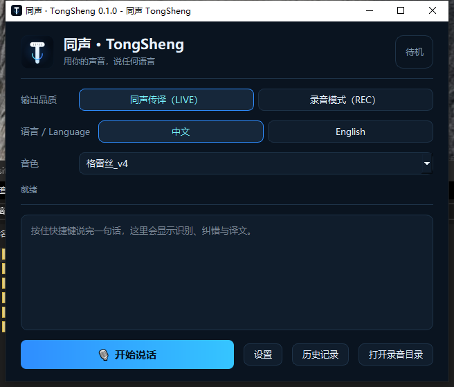

<div align="center">


# 同声 · TongSheng

**用你的声音，说任何语言。**
*Your voice, any language.*

本地语音翻译 · GPT-SoVITS 音色克隆 · Windows 托盘常驻

</div>

**中文** | [English](README.en.md)

> 作者：**Ahee52**
> 状态：**1.1.3**
> 打包构建：**TongSheng-1.1.3-Setup** — 安装后约 **14.1 GB**，安装包 **10.67 GB**（1 个 exe + 7 个 bin）
> 安装目录：`%ProgramFiles%\TongSheng`
> 配置 / 日志：`<安装目录>\config.yaml`、`<安装目录>\logs\app.log`
> 模型：`<安装目录>\GPT-SoVITS\GPT_SoVITS\pretrained_models`、`<安装目录>\models`

---

## ⚠️ 使用前请先读

**声音克隆必须经过声音所有者的明确、可撤回的授权。**

只训练**你本人**的声音，或你持有**书面许可**的声音。以下行为明确禁止：

- 冒充他人（亲属、公众人物、客服、官方机构）
- 诈骗、骚扰、色情或误导性内容
- 在声音所有者不知情的情况下克隆其声音

用于产品或公共服务时，请完成当地法律要求的告知与备案。因滥用产生的后果由使用者承担。

---

## 这个项目是什么

同声是一个 **Windows 系统托盘小工具**：按下快捷键说一句话，它把你说的话识别、纠错、翻译成另一种语言，然后用**你自己训练的声音**读出来。

```
                         ┌──────────────────────────────────────────────┐
   按下快捷键说话  →      │  ASR 识别 → 纠错 → 翻译 → 音色合成 → 播放/存盘 │  → 你的克隆音色
                         └──────────────────────────────────────────────┘
                                    全部在本机完成，音频不出本机
```

它由两个已经跑通的项目整合而来：

| 项目 | 贡献 |
|---|---|
| **A — PrivateVoice** | GPT-SoVITS 推理与训练、音色管理、模型预热 |
| **B — ALT-VoiceType** | ASR 适配层、纠错/翻译 prompt、llama-server 托管、Alt 手势交互 |

同声本身只做一件事：把这两条链路接成**一个键就能用**的产品。

---

## 仓库包含什么

```text
tongsheng/            应用代码（托盘 / 主窗口 / 服务编排 / ASR / 翻译 / TTS）
tongsheng/audio/      麦克风采集、流式播放、WAV 工具
tongsheng/asr/        FunASR（中文）与 faster-whisper（英文）适配器
tongsheng/llm/        OpenAI 兼容客户端 + llama-server 托管与健康检查
tongsheng/tts/        GPT-SoVITS 引擎、音色库、训练桥
tongsheng/ui/         主窗口、设置、训练窗口、电平表
tools/                开发启动脚本、打包脚本（build_package.py）
docs/                 截图、安装包体积评估
tests/                不需要 GPU 的单元测试
voice-repository/     克隆音色（默认只带 Default_Voice）
run.bat               一键启动
config.example.yaml   配置模板
```

| 包含 | 不包含 |
|---|---|
| 全部应用代码与中英双语界面 | 模型权重（安装包内置，源码运行需自行下载） |
| 音色训练 / 导入 / 校验工具 | 你训练出来的个人音色（`voice-repository/` 不入库） |
| 打包脚本与 Inno Setup 脚本 | `config.yaml`（个人配置，首次运行生成） |

---

## 两种使用方式

| 方式 | 适合 | 需要 |
|---|---|---|
| **安装包** | 直接使用 | 下载 1 个 `.exe` + 2 个 `.bin` 分卷 |
| **源码** | 开发 / 二次修改 | Python 3.12、NVIDIA 显卡、约 20 GB 磁盘、自行准备模型 |

安装包内置 Python 运行时与全部模型，装完即可说话，**不需要装 Python**。

---

## 硬件要求

| 项目 | 最低 | 推荐 |
|---|---|---|
| 系统 | Windows 10 x64 (21H2+) | Windows 11 x64 |
| 显卡 | NVIDIA RTX 2060 / 6 GB 显存 | **RTX 3090 / 4070 Ti / 5070 Ti，16–24 GB** |
| 驱动 | 支持 CUDA 12.8（≥ 570.x） | 最新 Game Ready / Studio |
| 内存 | 16 GB | 32 GB |
| 磁盘 | 15 GB 可用 | 30 GB（多音色 + 训练产物） |
| 音频 | 任意麦克风 | USB 声卡或带监听耳机 |
| 网络 | 运行不需要 | 仅首次下载模型时需要 |

说明：

- 推理常驻显存约 4–6 GB（ASR + TTS + 两个 LLM 服务）。
- 训练建议 24 GB；16 GB 会自动使用更保守的 batch。
- CPU 推理不支持（一句话要 30–60 秒，且 v4 依赖 GPU 算子）。
- 显存不足时训练会明确报错，而不是静默失败。

---

## 从源码运行

### 0. 准备

- Windows 10/11 x64、Git、NVIDIA 驱动
- Python **3.12**（安装包使用嵌入式 3.12 运行时）
- 约 20 GB 可用磁盘

### 1. 取代码与上游

```bat
git clone <本仓库> TongSheng
cd TongSheng

:: GPT-SoVITS 推理栈不随仓库分发
git clone https://github.com/RVC-Boss/GPT-SoVITS.git ..\PrivateVoice\GPT-SoVITS
```

### 2. 装依赖

```bat
python -m venv .venv
.venv\Scripts\activate

:: torch 需与你的 CUDA 匹配；安装包使用 cu128
pip install torch==2.11.0 torchaudio==2.11.0 --index-url https://download.pytorch.org/whl/cu128
pip install -r requirements.txt
```

### 3. 准备模型

源码运行时，程序会**自动发现同级目录**下的两个先行项目：

| 来源 | 用途 | 默认位置 |
|---|---|---|
| PrivateVoice | GPT-SoVITS 权重、ASR 缓存、训练音色 | `..\PrivateVoice`、`..\PrivateVoice\dist\*\models_cache` |
| ALT-VoiceType | 纠错 / 翻译 GGUF | `..\ALT-VoiceType\models` |

放在别处就在 `config.yaml` 里写死：

```yaml
paths:
  gpt_sovits: D:\PrivateVoice\GPT-SoVITS
  asr_cache:  D:\PrivateVoice\dist\PrivateVoice_Ahee52\models_cache
  gguf:       D:\ALT-VoiceType\models
```

### 4. 启动

```bat
run.bat             :: 托盘模式
run.bat doctor      :: 环境自检（路径 / 显卡 / 音色 / 引擎）
```

`run.bat` 默认使用 PrivateVoice 打包版自带的 Python 运行时（torch + CUDA + FunASR + faster-whisper 齐全）。
想用自己的虚拟环境就设 `TONGSHENG_PYTHON`。

首次运行会自动拉起两个本地 llama.cpp 服务：**纠错 8093 / 翻译 8094**（刻意避开项目 B 的 8091/8092），
已经健康的服务会直接复用，不会重复起进程。

### 5. 验证

```bat
python -m unittest discover -s tests -v
```

日志：`logs/app.log`；崩溃栈：`logs/crash.log`。

---

## 界面与交互



启动后打开控制窗口；关掉它只会收进托盘，双击托盘图标可以再打开。

```
同声
├─ 状态 · 待机
├─ 🎙 开始说话
├─ 保存合成音频（录音）        ← 勾选后才把每段合成写入 results/rec
├─ 输入语言（中文 / English）  ← 界面 + ASR 模型一起切并预热
├─ 输出语言（15 种）           ← 中英日韩可朗读，其余仅文字
├─ 音色                       ← voice-repository 下的克隆音色
├─ 打开主窗口 / 设置 / 历史记录 / 打开录音目录
└─ 退出
```

要点：

- **快捷键**：默认 **右 Alt**。`smart` 模式轻点锁定、长按说完松手；也能改成 `ctrl+alt`、`ctrl+shift+space`。
  钩子只监听、不吞键，Alt+Tab / Alt+F4 会自动取消录音。
- **ESC**：任何时候取消当前这段（录音、识别、播放都能打断）。
- **输入电平表**：窗口右侧竖条实时显示麦克风电平（峰值保持），说话前先确认有信号。
- **模型预热**：一键把 ASR / TTS / 翻译服务全部加载好，避免第一句卡顿。
- **声音模型训练**：右上角进入音色库，新建音色 / 设为默认 / 删除 / 导入已有音色。
- **输入语言不是识别器说了算**：whisper 实际听到的语种会覆盖界面标签，并据此决定翻译方向。

> Windows 会把新出现的托盘图标折叠进 `^` 隐藏区。点任务栏 `^` 把「同声」拖出来，或在
> 「任务栏设置 → 选择哪些图标显示」里打开它。不想每次启动都弹窗，就把 `ui.start_minimized` 设为 `true`。

---

## 它是怎么工作的

| 阶段 | 中文输入 | 英文输入 | 说明 |
|---|---|---|---|
| 识别 | FunASR Paraformer-zh | faster-whisper small | 切输入语言即换模型并预热 |
| 纠错 | Qwen3-1.7B（llama.cpp） | 同左 | 只改识别错误、不改原意；改动过大自动回退 |
| 翻译 | Index-Translate 2B / 9B | 同左 | 口语化意译，不是逐字直译 |
| 合成 | GPT-SoVITS **v4 + 训练 LoRA** | 同左 | 48 kHz，整段渲染，12 步采样 |
| 输出 | 扬声器 / `results/rec` | 同左 | 由「保存合成音频」开关决定是否落盘 |

**单一合成管线**：1.1.0 起取消了 LIVE / REC 双档，统一使用原「录音模式」的参数
（v4 · 48 kHz · 12 步 · 整段渲染 · 80 ms 句间停顿 · 12/25 ms 淡入淡出）。音色始终是你训练的那一个。

### 输出语言

| 能朗读（克隆音色） | 仅文字翻译 |
|---|---|
| 中文、English、日本語、한국어、粤语 | Español、Français、Deutsch、Русский、Português、Italiano、العربية、Tiếng Việt、ไทย、Bahasa Indonesia、Türkçe |

GPT-SoVITS 的前端只支持 zh / en / ja / ko / yue；选到其余 11 种时程序**只输出文字译文**
（转录区与粘贴都正常），绝不会用别的语言硬读。

### 录音与缓存

- 开关**打开**：每段合成写入 `results/rec/<时间戳>.wav`，长期保留
- 开关**关闭**：写入的缓存超过 **3 分钟**自动删除（每 60 秒清扫一次，启动时也扫一次）

---

## 训练 / 导入你的声音

### 导入已有音色

```bat
run.bat voices import --from "C:\path\to\character-folder"
run.bat voices list
```

### 用一段录音训练新音色

```bat
run.bat train --audio D:\我的录音.wav --name 我的声音
```

流程：切分 → 逐句 ASR 打标 → 生成训练集 → LoRA 训练（默认 conservative，约 200 step）→ 自动装进
`voice-repository/`。训练期间会释放 ASR / TTS 占用的显存；24 GB 显卡上 200 step 约 10–15 分钟。

### 音色目录结构

```
voice-repository/<id>/
├─ profile.json         名称、权重路径、参考音频文本与语种
├─ reference.wav/.txt    参考音频（提示词音色来源）
└─ checkpoints/          s1 GPT ckpt + SoVITS v4 LoRA
```

参考文本的语种由程序自动判断，不依赖 profile 里的旧字段——英文参考音频配中文音素提示词会让发音拖沓。

---

## 配置

复制 `config.example.yaml` 为 `config.yaml`，或直接在托盘「设置」里改（会自动写回）。常用项：

| 键 | 默认 | 说明 |
|---|---|---|
| `ui.language` | `zh` | 输入语言 + 界面语言（`zh` / `en`） |
| `ui.record_output` | `false` | 是否把合成音频保存到 `results/rec` |
| `ui.hotkey` | `ralt` | `lalt` / `ralt` / `alt` / `ctrl+alt` / `ctrl+shift+space` |
| `ui.hotkey_mode` | `smart` | `smart` 轻点锁定+长按说话 / `hold` 按住 / `toggle` 按一下 |
| `ui.start_minimized` | `false` | 启动只进托盘，不弹窗口 |
| `translate.target_language` | `""` | 输出语言；留空 = 自动取输入的反向 |
| `translate.style` | `daily` | `daily` / `live` / `business` / `subtitle` |
| `tts.speed` | `1.0` | 语速（主界面滑块，项目 A 推荐 0.92） |
| `tts.emotion` | `natural` | `natural` / `gentle` / `lively` / `calm` / `serious` |
| `tts.sentence_gap_ms` | `80` | 句间停顿 |
| `tts.max_chars_per_sentence` | `40` | 单句上限（下限 6 字，碎片自动并入相邻句） |
| `audio.input_device` | `null` | 麦克风名片段或序号 |
| `audio.output_device` | `null` | 输出设备序号 |
| `pipeline.inject_text` | `false` | 译文用 Ctrl+V 粘贴到光标处，并自动恢复原剪贴板 |

配置查找顺序：`--config` 参数 → 项目根 `config.yaml` → 内置默认值。

---

## 打包

```bat
:: 1) 收集文件（硬链接，先退出正在运行的同声）
python tools\build_package.py --stage

:: 2) 生成安装向导素材（深色卡片 + 应用图标）
python tools\make_installer_assets.py

:: 3) 编译安装包（英文向导，1.9 GB 分卷，适配 GitHub Releases 单文件 2 GB 上限）
"%LOCALAPPDATA%\Programs\Inno Setup 6\ISCC.exe" installer\TongSheng.iss
```

产物在 `dist\installer\`（实测 10.67 GB，LZMA2 压缩率约 0.74）：

```
TongSheng-1.1.3-Setup.exe      6.1 MB     引导程序（含图标与英文向导）
TongSheng-1.1.3-Setup-1.bin    1.77 GB    数据分卷 1
TongSheng-1.1.3-Setup-2…6.bin  1.77 GB    数据分卷 2–6
TongSheng-1.1.3-Setup-7.bin    28 MB      数据分卷 7
SHA256SUMS.txt                            校验和
```

安装界面为**纯英文**，配色与图标跟随本项目（深色卡片 + TS 麦克风图标）。
上传 GitHub Release 时把 `.exe` 和所有 `.bin` 一起放进去，缺一卷都装不上。

实测体积（仅 `Default_Voice`）：

| 组成 | MB |
|---|---:|
| Python 运行时（torch 4.19 / PySide6 / onnxruntime） | 5888 |
| 语音识别模型（paraformer + ct-punc + whisper small） | 2681 |
| LLM 权重（Qwen3-1.7B Q8 + Index-Translate-2B Q4） | 2995 |
| GPT-SoVITS 代码 + v4 预训练权重 | 2527 |
| Default_Voice 音色 | 221 |
| llama-server + DLL | 168 |
| 应用代码与文档 | 6 |
| **合计** | **14480（约 14.1 GB）** |

安装包按 0.86 压缩率估算约 **12.1 GB**。打包时**必须排除**：`logs/`、`results/`、`.git/`、
`__pycache__/`、`GPT-SoVITS/TEMP/`、`GPT_weights_v3/`、`SoVITS_weights_v*/`、
`pretrained_models/models--nvidia--bigvgan_v2_24khz*/`（v3 专用）、`G2PWModel.zip`、
`models_cache/models/`（与 `modelscope/` 重复的 paraformer）。详见 [docs/INSTALLER-SIZE.md](docs/INSTALLER-SIZE.md)。

---

## 常见问题

**没有声音？**
看 `logs/app.log` 里的 `speak` 行与错误；确认 `voice-repository/<音色>/checkpoints/` 下有 GPT ckpt 与 LoRA 两个文件。

**翻译很慢或报错？**
看 `logs/translator.log` / `logs/corrector.log`。GGUF 文件名与 `config.yaml` 里的 `llm.*.model` 必须一致。

**提示服务 90 秒未就绪？**
1.1.3 起健康检查已兼容 llama.cpp 的两种返回格式（`data` / `models`）。若仍失败，检查 8093/8094 是否被别的程序占用，以及**系统代理**是否劫持了 localhost（1.1.3 起已内置免代理）。

**快捷键没反应？**
换一个组合，某些安全软件会拦截全局键盘钩子；程序每 3 秒自检一次钩子，失效会自动重连并写日志。

**停止键 / ESC 没反应？**
1.0.2 起已修：处理中按快捷键或 ESC 会取消当前这段并强制回到待机；上一段卡住的线程会被放弃，不会阻塞下一句。

**装完怎么确认能用？**
开始菜单 → **Self-test**（或 `runtime\python.exe tools\selftest.py`），逐项检查
GPU / 模型 / 音频 / 英文音素 / ASR / 合成 / 训练，报告在 `logs\selftest.txt`。

**录音文件在哪？**
开关打开时在 `results/rec/`；关闭时只保留约 3 分钟。

**能复制音色到别的机器吗？**
可以，整目录拷进 `voice-repository/` 即可，音色库会自动重建索引；不要改权重文件名。

---

## 已知限制

- 输出 11 种语言只有文字，没有语音
- 不支持 CPU 推理，不支持 AMD / Intel 显卡
- 蓝牙耳机 / HDMI 音频需要手动选择设备（本项目只保证 3.5 mm 与 USB 声卡路径可用）
- 虚拟麦克风（把合成语音送进聊天软件）需要额外的虚拟声卡，暂未内置

---

## 许可证

本仓库代码以 **MIT** 发布，见 [LICENSE](LICENSE)。

依赖与权重各自遵循其许可：GPT-SoVITS（MIT）、FunASR（MIT）、faster-whisper（MIT）、
CTranslate2（MIT）、llama.cpp（MIT）、PySide6（LGPLv3，动态链接）、ModelScope（Apache-2.0），
以及 chinese-roberta / chinese-hubert / paraformer / whisper / Index-Translate 权重各自的发布条款。
详见 [THIRD_PARTY.md](THIRD_PARTY.md)。

---

## 致谢

- [GPT-SoVITS](https://github.com/RVC-Boss/GPT-SoVITS) — 音色克隆与合成
- [FunASR](https://github.com/modelscope/FunASR) — 中文语音识别
- [faster-whisper](https://github.com/SYSTRAN/faster-whisper) — 多语言识别
- [llama.cpp](https://github.com/ggml-org/llama.cpp) — 本地 LLM 推理
- [Index-Translate](https://huggingface.co/IndexTeam) — 翻译模型
- [PySide6](https://www.qt.io/qt-for-python) — 托盘与窗口界面

代码整合自两个先行项目，均已获得作者授权：

- **Project A — PrivateVoice**（MIT）：GPT-SoVITS 推理/训练、音色管理
- **Project B — ALT-VoiceType**（Apache-2.0）：ASR 适配、纠错与翻译 prompt、llama-server 托管

---

## 版本

| 版本 | 主要内容 |
|---|---|
| 1.1.3 | 修复英文合成（NLTK 硬链接）与训练（缺 app 后端）；可写数据目录；安装后自检 |
| 1.1.2 | 修复安装版无法启动：打包版路径发现、内置 llama-server、FunASR 缓存布局、启动失败弹窗 |
| 1.1.1 | 转录不再重复显示同一句；按识别到的真实语种标注 |
| 1.1.0 | 取消双档，统一录音参数；「输出品质」改为录音开关；关闭时 3 分钟清理缓存 |
| 1.0.8 | 自适应分块 + 批量推理（后因统一管线废弃） |
| 1.0.7 | LIVE 音质对齐 REC（12 步、共用引擎） |
| 1.0.6 | LIVE 改用训练好的 v4 音色（此前静默回退到 v3 零样本） |
| 1.0.3 | 修复系统代理劫持 localhost、僵尸 llama-server、端口冲突 |
| 1.0.2 | 修复停止键 / ESC 卡死 |
| 1.0.1 | 冻结点：双档合成、15 种输出语言、音色训练 |

完整记录见 [CHANGELOG.md](CHANGELOG.md)。

---

## 最后一件事

它最初只是为了在安静的夜里，能用自己的声音说一句别的语言。

如果你能用它帮到一个人——语言不通的同事、听力不便的家人、需要跨语言沟通的场景——
那它就不只是一个语音合成的演示。

**愿沟通无碍，愿声音被善待。**
